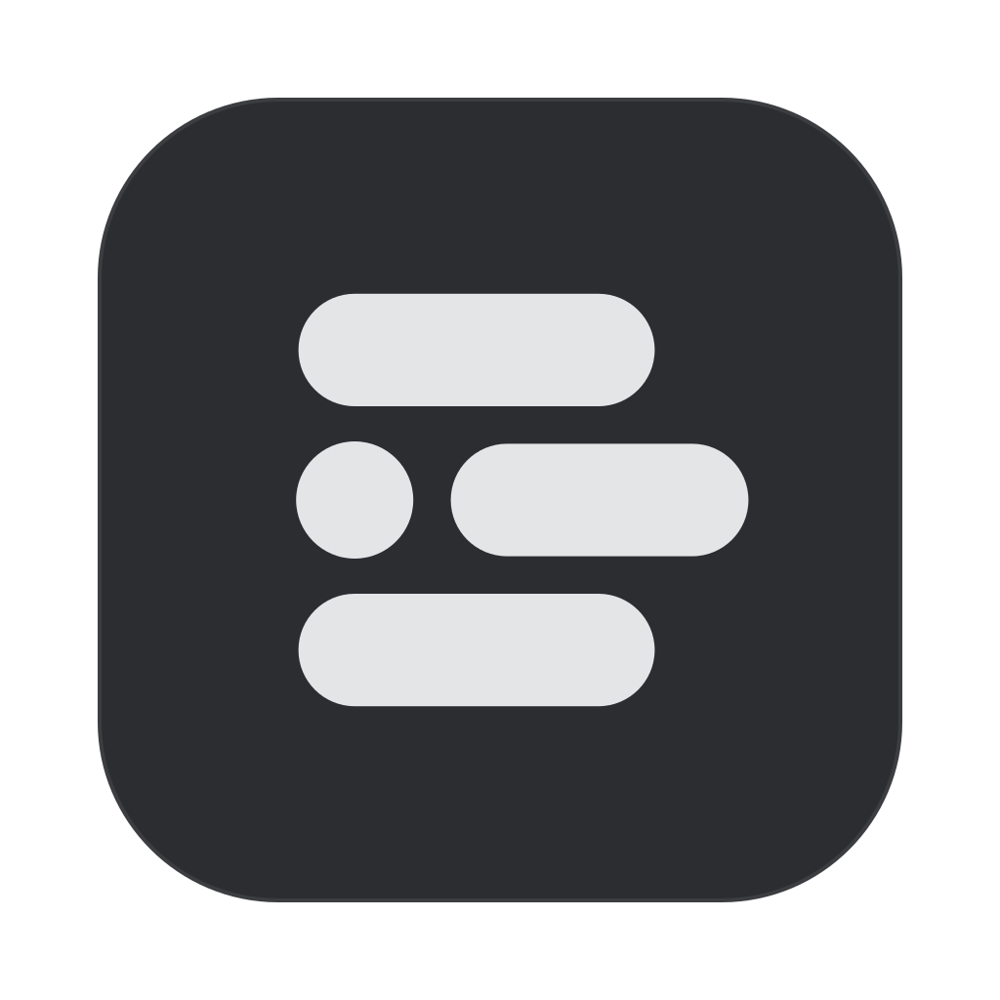

<div align="center">



# AssignedToMe

**Every task assigned to you, from every board you use, in one place.**

A fast app that pulls your assigned issues from Jira, Linear, GitHub, GitLab, Azure DevOps and Bitbucket into a single list, so you stop hopping between tabs to find out what's on your plate. Use it on the web, or keep it in your macOS menubar.

**[🌐 Open the web app](https://assignedtome.xyz)** &nbsp;·&nbsp; **[⬇ Download for macOS](https://github.com/enesakkose/AssignedToMe/releases/latest)** &nbsp;·&nbsp; Apple Silicon & Intel &nbsp;·&nbsp; macOS 13+

<p>
  &nbsp;&nbsp;
  &nbsp;&nbsp;
  <picture>
    <source media="(prefers-color-scheme: dark)" srcset="docs/assets/providers/github-dark.svg" />
    
  </picture>&nbsp;&nbsp;
  &nbsp;&nbsp;
  &nbsp;&nbsp;
  
</p>

</div>

---

## Why

Your work is spread out: a client's Jira, your team's Linear, a few GitHub repos. Each one has its own "assigned to me" view, and none of them sees the others. AssignedToMe connects to all of them and shows one list, one click away in your menubar. Every task links straight back to where it lives.

## Features

- **One list, every board.** All your assigned tasks together, or one board at a time. Each connected board gets its own tab (in the menubar) or sidebar entry (in the window), and you can rename it.
- **Lives in the menubar.** A click on the menubar icon shows your tasks over whatever you're doing, even a full-screen app. The icon shows how many tasks you have.
- **Or use it as a window.** Open the full window with a boards sidebar. Close the window and the app keeps running in the menubar. You can also choose "menubar only".
- **Act without switching apps.** Change status, reassign, comment and log time, where the tool supports it (see the table below).
- **Task details.** Description with images, sub-tasks, epic issues, linked and blocking issues.
- **Search and filter.** Search your tasks instantly; on a Jira board, also search the whole project. Filter by status, type, priority, sprint and time logged.
- **New task notifications.** A macOS notification when something new is assigned to you. Clicking it opens that task.
- **Copy a link or ID.** Right-click a task to copy its URL, or just its key (e.g. `ENG-142`) for a branch name.
- **Stays fresh on its own.** Refreshes every hour by default (or every 1, 15 or 30 minutes), and again when you open it.
- **Updates itself.** When a new version is out, a bar under your tasks offers to update and restart. Every update is checked against our signing key before it installs.
- **Feels native.** Light and dark mode, English and Turkish, keyboard shortcuts, launch at login (on by default; turn it off in Settings), reduced-motion support.

## Supported tools

| | Tool | What you need | Status | Comments | Assign | Log time | Sub-tasks & links |
|---|---|---|:-:|:-:|:-:|:-:|:-:|
|  | **Jira Cloud** | Email + [API token](https://id.atlassian.com/manage-profile/security/api-tokens) | ✓ | ✓ | ✓ | ✓ | ✓ |
|  | **Jira Data Center / Server** | Personal access token (Jira 8.14+), or username + password on older versions | ✓ | ✓ | ✓ | ✓ | ✓ |
|  | **Linear** | Personal API key (Read) | — | — | — | — | — |
| <picture><source media="(prefers-color-scheme: dark)" srcset="docs/assets/providers/github-dark.svg" /></picture> | **GitHub** | Classic personal access token (`repo`, plus `project` for Projects status) | ✓ | ✓ | — | — | ✓ |
|  | **GitLab** (gitlab.com or self-hosted) | Personal access token (`api`) | ✓ | ✓ | — | — | — |
|  | **Azure DevOps** | Personal access token (Work Items: Read & write) | ✓ | ✓ | — | — | — |
|  | **Bitbucket Data Center** | HTTP access token (Repository: Read) | ✓ | ✓ | — | — | — |

You don't need to look any of this up: when you add a board, the app walks you through creating the right token, step by step, with links and copy buttons.

A few notes:
- **GitHub status** covers opening and closing issues, plus the **Status** field (Todo / In Progress / Done) when an issue belongs to a GitHub Project. **Sub-tasks** on GitHub are its sub-issues.
- **GitHub organizations with SAML SSO:** after creating the token, click **Configure SSO** next to it and authorize each organization, or that organization's issues won't appear.
- **Linear** is read-only for now: you see and open your issues, and actions happen in Linear.
- **Bitbucket** shows the pull requests waiting on your review. **Status** there means approving, requesting changes or resetting your review, and you can read and reply to PR comments. It targets **Bitbucket Data Center/Server**; if its API is behind a VPN, you must be connected to that network for the board to load.

## Your data stays yours

- **No server, no account, no tracking.** The app talks directly from your Mac to each tool's own API. There is no backend in between, and no analytics or telemetry.
- **Tokens live in the macOS Keychain.** They are never written to plain files, logs or URLs, and are only ever sent to the tool they belong to.
- **HTTPS only.** Connections to http addresses are refused.
- **It respects company networks.** If a corporate proxy or firewall blocks an API, the app says so and offers to open the task in your browser. It never tries to get around the block.
- **Untrusted content is sanitized.** Descriptions and comments from your tools are cleaned before they're shown, and only `http(s)` links are opened.

## Getting started

AssignedToMe runs on **macOS 13 (Ventura) or later**, on both Apple Silicon and Intel Macs.

### Install

1. Download the latest **`AssignedToMe_…_universal.dmg`** from [Releases](https://github.com/enesakkose/AssignedToMe/releases/latest).
2. Open it and drag **AssignedToMe** into **Applications**.
3. Open it from Applications.

Releases are signed with a Developer ID and notarized by Apple, so macOS opens them without warnings. From then on the app updates itself (from 0.1.3 on; if you have 0.1.2 or older, download the latest release once). Prefer to build it yourself? It's all open source: [build from source](#development) in a few minutes.

### First run

1. The app opens its window with a short intro, where you also choose **Window + menubar** or **Menubar only** (changeable later in Settings).
2. Choose **Connect a board**.
3. Pick your tool, follow the steps to create a token, paste it in, and press **Save**. Your tasks appear right away.
4. Add as many boards as you like. Rename them by double-clicking their tab, or from the board's **⋯** menu.

### Keyboard shortcuts

| Shortcut | Action |
|---|---|
| `⌘F` | Search |
| `⌘R` | Refresh all boards |
| `⌘,` | Settings |
| `Esc` | Close a task, or go back |

## Development

### Prerequisites

- [Bun](https://bun.sh) (package manager and test runner)
- [Rust](https://www.rust-lang.org/tools/install) (stable, via rustup)
- Xcode Command Line Tools: `xcode-select --install`

### Run it

```bash
bun install
cd desktop
bun tauri dev
```

> In `tauri dev`, tokens are kept in a plain file in the app's data folder instead of the Keychain. That's because each rebuild is a new unsigned binary, and macOS would otherwise ask for your Keychain password on every change. Release builds always use the Keychain.

### Build a release

```bash
cd desktop
bun tauri build --target universal-apple-darwin
```

This builds one app for both Apple Silicon and Intel (it needs both Rust targets: `rustup target add aarch64-apple-darwin x86_64-apple-darwin`). The `.app` and `.dmg` end up in `desktop/src-tauri/target/universal-apple-darwin/release/bundle/`. For just your own Mac, plain `bun tauri build` is faster.

A build made this way is fine for your own Mac. To sign and notarize it for others (as the published releases are), you need an Apple Developer account: set `APPLE_SIGNING_IDENTITY` to your "Developer ID Application" certificate and provide notarization credentials (`APPLE_API_KEY` + `APPLE_API_ISSUER` with the matching `.p8` key) when running the build. See Tauri's [macOS code signing guide](https://v2.tauri.app/distribute/sign/macos/). No credentials ever go into the repository.

### Releasing

For maintainers. A release needs the Apple signing and notarization credentials (see above) plus the **updater signing key**, whose private half never leaves the maintainer's machine; its public half is the `pubkey` in `tauri.conf.json`.

1. Bump the version in `desktop/src-tauri/tauri.conf.json`, `desktop/src-tauri/Cargo.toml` and `desktop/package.json`.
2. Build with `TAURI_SIGNING_PRIVATE_KEY` (path to the updater key) and `TAURI_SIGNING_PRIVATE_KEY_PASSWORD` set, alongside the Apple variables. The build then also writes `AssignedToMe.app.tar.gz` and its `.sig`.
3. `cd desktop && bun scripts/latest-json.ts "What changed"` writes `latest.json`.
4. Create release `v<version>` and upload three files: the `.dmg`, `AssignedToMe.app.tar.gz` and `latest.json`. Running apps find it through `releases/latest/download/latest.json`.

If the updater key is lost, installed apps can no longer be updated automatically, so keep a backup.

### Test and check

From the repository root:

```bash
(cd packages/core && bun run check)                    # typecheck + tests for the shared provider logic
(cd desktop && bunx tsc --noEmit && bunx oxlint src)   # app typecheck + lint
(cd desktop/src-tauri && cargo check)                  # Rust side
```

### Project structure

```
packages/core/   Shared TypeScript: provider adapters, types, schemas. No platform code.
desktop/         The macOS app: Tauri v2 + React + Vite + Tailwind + Base UI.
  src/           UI (features/, components/, lib/, locales/)
  src-tauri/     Rust side: menubar, windows, Keychain, permissions
  design/logo/   Logo sources and usage rules (GUIDELINES.md)
web/             The web app: Next.js, shares packages/core (live at assignedtome.xyz)
mobile/          Expo / React Native app (early stage)
docs/assets/     Images used by this README
```

The web app lives in `web/` (Next.js) and shares `packages/core` the same way; it's live at [assignedtome.xyz](https://assignedtome.xyz).

Every provider lives in `packages/core/src/providers/<id>/` and implements one `Provider` interface: its logo, form fields, the step-by-step token guide (English and Turkish), and functions like `validate`, `fetchMyTasks`, `transition` or `getComments`. The apps render forms, guides and actions from that object. When a provider leaves out a function, the UI simply hides that action.

### Adding a provider

1. Create `packages/core/src/providers/<id>/index.ts` exporting a `Provider`.
2. Parse every API response with [zod](https://zod.dev) and map it to the shared `Task` type. The task's `url` must open the exact task in its source.
3. Register it in `packages/core/src/index.ts`.
4. Add tests next to it (`<id>.test.ts`) with a stubbed `fetch`.

No app code should need to change; if it does, the shared interface is missing something.

## Contributing

Issues and pull requests are welcome. Before you open a PR:

- Keep changes small and focused, and match the surrounding style.
- Run the checks above; new logic (parsers, providers, refresh, secrets) comes with a test.
- Follow the security rules: secrets only in the platform's secure store, every external payload validated, no workarounds for corporate network controls.

[`AGENTS.md`](AGENTS.md) has the full conventions, and each app has its own `AGENTS.md` and `DESIGN.md`.

## License

[MIT](LICENSE) © 2026 Enes Akkose

The `mobile/` app starts from an Expo template, which keeps its own MIT license in [`mobile/LICENSE`](mobile/LICENSE).
